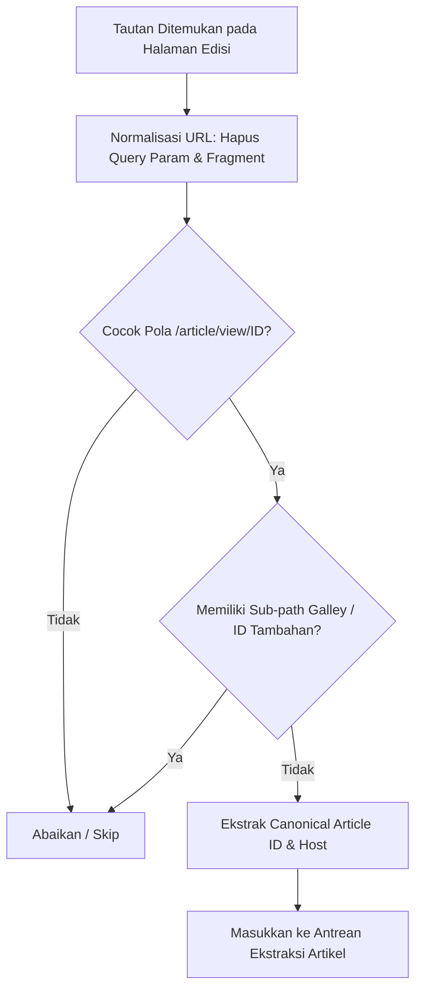
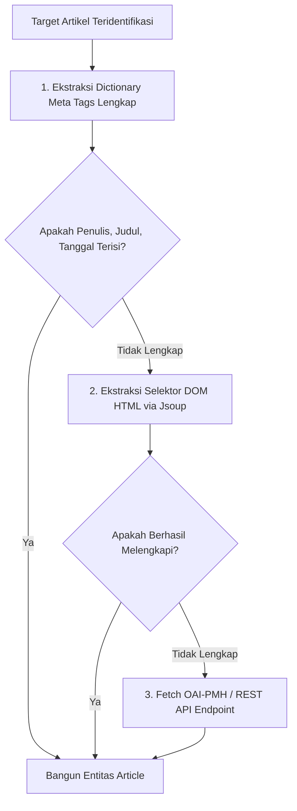
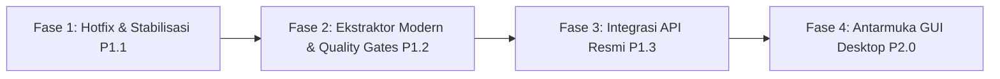

# Analisis Desain Masa Depan dan Roadmap Pengembangan GoCrawl

Dokumen ini merumuskan perbaikan arsitektural dan peta jalan implementasi (*engineering roadmap*) untuk memastikan proses crawling GoCrawl di masa depan menghasilkan data yang bersih, lengkap, bebas duplikasi, dan andal (*robust*).

---

## 1. Prinsip Desain Crawling Masa Depan

1. **Determinisme dan Integritas URL:** Mengindeks hanya halaman kanonikal metadata artikel; menolak seluruh artefak viewer atau file biner pada tahap deteksi URL.
2. **Deduplikasi Berlapis (*Multi-Tier Deduplication*):** Mencegah duplikasi data tidak hanya melalui string URL, melainkan melalui identitas digital permanen (DOI) dan sidik jari konten (*content fingerprinting*).
3. **Ekstraksi Bertingkat (*Cascading Metadata Extractor*):** Memprioritaskan antarmuka terstruktur resmi (OAI-PMH / REST API), disusul meta tags komprehensif, dan *fallback* ke penyeleksi DOM HTML.
4. **Gerbang Kualitas Data (*Data Quality Gates*):** Menolak atau mengarantina entitas data yang tidak memenuhi ambang batas kelengkapan skema sebelum masuk ke file output.
5. **Pemisahan Tanggung Jawab (*Separation of Concerns*):** Memecah arsitektur monolitik menjadi modul-modul independen yang dapat diuji (*testable*).

---

## 2. Solusi Teknis Terinci

### 2.1 Solusi Masalah 1: URL Filtering & Canonicalization Engine

Untuk menuntaskan masalah duplikasi halaman viewer (`/article/view/{id}/{galleyId}`), sistem traversal URL harus menerapkan aturan validasi ketat:

#### A. Regex Pola URL Artikel Resmi
URL artikel OJS yang valid harus memenuhi pola:
```regex
^(https?://[^/]+(?:/.*)?/article/view/(\d+))/?(?:$|[?#].*$)
```
- **Group 1:** URL kanonikal dasar (misal: `https://.../article/view/12693`).
- **Group 2:** ID numerik unik artikel (`articleId = 12693`).

#### B. Blacklist Pattern untuk Link Galley / Viewer
Semua tautan yang memuat pola berikut **wajib langsung diabaikan** pada saat parsing tautan edisi:
- `/article/view/\d+/\d+.*` (Galley ID OJS 3)
- `/article/view/\d+/pdf.*` (Galley label)
- `/article/download/.*` (Direct download file)
- `/article/viewFile/.*` (OJS 2 galley download)



---

### 2.2 Solusi Masalah 2: Deduplikasi Berlapis (Multi-Tier Deduplication)

Untuk mengantisipasi situasi di mana URL berbeda namun merujuk pada karya yang sama (misal DOI galley vs DOI artikel, atau HTTP vs HTTPS), diterapkan engine deduplikasi 3 lapis:

```
[Kandidat Artikel Baru]
        │
        ├── Lapis 1: Canonical Article Key (Host + Article ID)
        │     └── Jika sudah terdaftar -> REJECT
        │
        ├── Lapis 2: Normalized DOI
        │     └── Standarisasi: lowercase, strip "https://doi.org/", strip suffix ".gXXXX"
        │     └── Jika DOI terdaftar -> REJECT
        │
        └── Lapis 3: Semantic Content Fingerprint
              └── Hash(Normalize(Title) + Normalize(FirstAuthor) + Year)
              └── Jika Hash terdaftar -> REJECT
```

#### Spesifikasi Normalisasi DOI:
- Bentuk input: `https://doi.org/10.24235/tamaddun.v13i2.21442.g7209`
- Aturan transformasi:
  1. Hapus resolver prefix: `10.24235/tamaddun.v13i2.21442.g7209`
  2. Hapus suffix galley OJS: Regex `\\.g\\d+$` &rarr; `10.24235/tamaddun.v13i2.21442`
  3. Konversi ke huruf kecil: `10.24235/tamaddun.v13i2.21442`

#### Spesifikasi Semantic Content Fingerprint:
- Judul dinormalisasi: huruf kecil, buang prefiks `"view of "`, `"tampilan "`, dan seluruh tanda baca non-alfanumerik.
- Penulis pertama: diambil hanya kata terakhir (*surname*).
- Contoh:
  - Judul: `"View of Masjid Baiturrohim Ringinwok: Sejarah..."` &rarr; `masjid baiturrohim ringinwok sejarah`
  - Penulis: `"Fida Qurratu Aini"` &rarr; `aini`
  - Tahun: `2026`
  - Key: `SHA256("masjid baiturrohim ringinwok sejarah|aini|2026")`

---

### 2.3 Solusi Masalah 3: Strategi Ekstraksi Kaskade (Cascading Metadata Extractor)

Untuk mengatasi *missing values* pada kolom `published`, `abstract`, dan `authors`, ekstraksi metadata dialihkan dari satu parser menjadi model kaskade berlapis:



#### Kamus Meta Tag Lengkap (Extended Metadata Dictionary)

| Atribut Target | Daftar Key Meta Tag yang Wajib Diperiksa (Prioritas Kiri ke Kanan) |
|---|---|
| `published` | `citation_publication_date`, `citation_date`, `citation_cover_date`, `citation_online_date`, `dc.date.issued`, `dc.date`, `dc.date.created`, `prism.publicationdate` |
| `title` | `citation_title`, `dc.title`, `dc.title.alternative`, `og:title` *(Dilarang menggunakan `<title>` tanpa sanitasi)* |
| `authors` | `citation_author`, `dc.creator`, `dc.contributor.author`, `author` |
| `abstract` | `citation_abstract_html_url`, `citation_abstract`, `dc.description`, `dc.description.abstract`, `og:description` |
| `doi` | `citation_doi`, `dc.identifier.doi`, `dc.identifier`, `prism.doi` |
| `journal` | `citation_journal_title`, `citation_journal_abbrev`, `dc.source`, `dc.relation.ispartof` |

#### DOM Fallback Selectors (Menggunakan Jsoup)
Jika pengelola OJS menonaktifkan plugin meta tag Google Scholar, ekstraktor jatuh ke CSS selector baku OJS 3:
- **Judul:** `.page_article .page_title`, `h1.entry-title`
- **Penulis:** `ul.authors li .name`, `.author-name`
- **Abstrak:** `.item.abstract .value`, `section.item.abstract`
- **Tanggal:** `.item.published .value` (Format `YYYY-MM-DD` / teks tanggal)
- **DOI:** `.item.doi .value a`

---

### 2.4 Gerbang Kualitas Data & Sanitasi (Data Quality Gates)

Setiap kandidat artikel sebelum diterima oleh `ArticleSink` wajib melalui validator:

```java
public boolean isValid(Article a) {
    // 1. Tolak jika judul kosong atau terindikasi artefak viewer
    if (a.title().isBlank()) return false;
    String cleanTitle = a.title().toLowerCase();
    if (cleanTitle.startsWith("view of ") || cleanTitle.startsWith("tampilan ")) return false;

    // 2. Tolak ghost record (record tanpa penulis DAN tanpa abstrak DAN tanpa DOI)
    if (a.authors().isBlank() && a.abstractText().isBlank() && a.doi().isBlank()) return false;

    // 3. Validasi minimal panjang abstrak (jika ada, bukan sekadar teks disclaimer)
    if (!a.abstractText().isBlank() && a.abstractText().length() < 20) return false;

    return true;
}
```

#### Pembersihan Teks (Sanitizer Pipeline):
- **Unescape HTML Entities:** Mengubah `&nbsp;`, `&quot;`, `&#39;`, `&amp;` menjadi representasi karakter sebenarnya.
- **Pembersihan Mojibake:** Mendeteksi byte UTF-8 terenkapsulasi Latin-1 dan mendekode ulang secara transparan.
- **Normalisasi Spasi:** Mengganti spasi ganda, `\r\n`, `\t` menjadi spasi tunggal.

---

## 3. Rencana Refaktorisasi Arsitektur Kode

Kode monolitik `Main.java` (314 baris) direstrukturisasi menjadi paket modular:

```text
id.gocrawl
 ├── cli/
 │    ├── CommandLineOptions.java   : Parsing argumen & validasi flag CLI.
 │    └── GoCrawlApp.java           : Entry point utama eksekusi.
 ├── crawler/
 │    ├── CrawlEngine.java          : Orkestrator crawling multi-target.
 │    ├── OjsTraverser.java         : Algoritma traversal edisi dan arsip OJS.
 │    ├── UrlFilter.java            : Validator regex pola URL artikel & blacklist galley.
 │    └── RateLimiter.java          : Politeness delay & retry backoff.
 ├── extractor/
 │    ├── MetadataExtractor.java    : Interface ekstraktor metadata.
 │    ├── CascadingExtractor.java   : Implementasi kaskade (Meta Tags -> DOM Jsoup).
 │    └── ExtendedMetaDictionary.java: Pemetaan lengkap alias atribut akademik.
 ├── dedup/
 │    ├── DeduplicationService.java : Manajemen memori cache deduplikasi 3 lapis.
 │    └── ContentFingerprint.java   : Pembuat hash identitas artikel.
 ├── quality/
 │    ├── QualityGate.java          : Validasi kelengkapan data & filter sampah.
 │    └── TextSanitizer.java        : Normalisasi encoding, spasi, dan entity.
 ├── model/
 │    └── Article.java              : Record model metadata referensi.
 └── storage/
      ├── ArticleSink.java          : Interface writer.
      ├── CsvArticleSink.java       : Serialisasi CSV dengan proteksi escaping.
      └── JsonArticleSink.java      : Serialisasi JSON UTF-8 konsisten.
```

---

## 4. Roadmap Pentahapan Implementasi



### Fase 1: Hotfix & Stabilisasi Cepat (P1.1) [SELESAI TERIMPLEMENTASI]
- **Target:** Menghilangkan duplikasi "View of..." dan memperbaiki kolom `published` kosong pada kode eksisting.
- **Aksi:**
  1. Perbarui regex filter tautan di `crawlIssue` agar menolak URL yang memiliki segmen setelah ID artikel.
  2. Tambahkan `citation_date` pada ekstraksi variabel `published`.
  3. Tambahkan pembersih string untuk memotong awalan `"View of "` dan `"Tampilan "`.
  4. Perluas deduplikasi ke level ID artikel.

### Fase 2: Ekstraktor Modern & Quality Gates (P1.2) [SELESAI TERIMPLEMENTASI]
- **Target:** Kualitas ekstraksi maksimal dan penanganan HTML5 yang tangguh.
- **Aksi:**
  1. Tambahkan dependensi `org.jsoup:jsoup` di `pom.xml` dan bundling standalone jar.
  2. Implementasikan `CascadingExtractor` dengan dictionary meta tag lengkap dan fallback CSS selector.
  3. Terapkan `QualityGate` untuk membuang *ghost records*.
  4. Implementasikan pemulihan encoding mojibake otomatis.

### Fase 3: Integrasi API Resmi & Protokol Akademik (P1.3) [TAHAP BERIKUTNYA]
- **Target:** Ekstraksi berkecepatan tinggi tanpa scraping HTML.
- **Aksi:**
  1. Implementasikan konektor protokol **OAI-PMH** (`/oai?verb=ListRecords&metadataPrefix=oai_dc`).
  2. Tambahkan dukungan OJS REST API v1 (`/api/v1/submissions`).
  3. Konfigurasi fallback otomatis: API &rarr; HTML Traversal.

### Fase 4: Antarmuka GUI Desktop JavaFX (P2.0)
- **Target:** Memenuhi spesifikasi dokumen `plans/rencana-proyek-webcrawler-referensi.md`.
- **Aksi:**
  1. Bangun antarmuka desktop berbasis JavaFX (tanpa FXML/CSS).
  2. Integrasikan worker thread asinkron untuk pencarian live.
  3. Sediakan tabel hasil pencarian dengan kemampuan filter tahun, klik tautan langsung ke browser, dan ekspor BibTeX/CSV.
