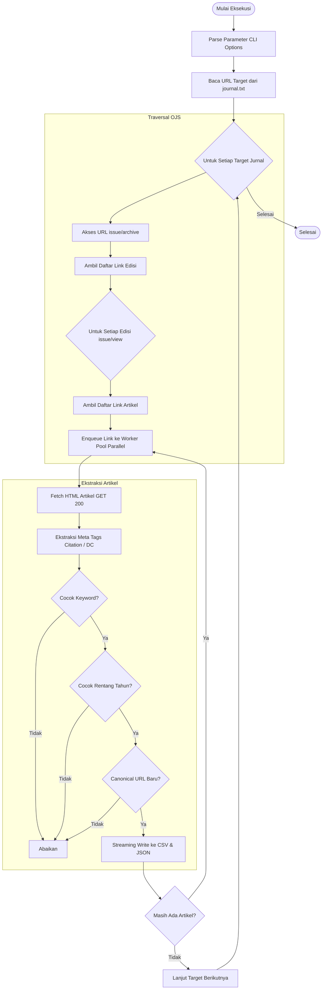

# Spesifikasi Teknis dan Dokumentasi Sistem GoCrawl (P1)

## 1. Ikhtisar Sistem

**GoCrawl P1** adalah aplikasi desktop CLI (*Command Line Interface*) berbasis Java 21 LTS yang dirancang untuk mengindeks dan mengekstraksi metadata artikel ilmiah secara otomatis dari portal jurnal berbasis **Open Journal Systems (OJS)**.

Sistem bekerja dengan memetakan hierarki OJS (Arsip Edisi &rarr; Daftar Artikel per Edisi &rarr; Halaman Artikel), mengekstraksi metadata standar sitasi dari dokumen HTML, memfilter berdasarkan kueri kata kunci dan rentang tahun, kemudian menyimpan hasilnya dalam format terstruktur CSV dan JSON.

---

## 2. Lingkungan dan Dependensi

Sistem dibangun tanpa pustaka eksternal (*zero external dependencies*) pada tahap P1 untuk meminimalkan beban ketergantungan runtime:
- **Runtime:** Java Standard Edition 21 LTS.
- **Klien HTTP:** `java.net.http.HttpClient` (HTTP/2 capable, sinkron/asinkron, koneksi persisten).
- **Parser HTML:** `javax.swing.text.html.parser.ParserDelegator` dengan `HTMLEditorKit.ParserCallback`.
- **Konkurensi:** `java.util.concurrent.Executors.newFixedThreadPool(3)` untuk pemrosesan paralel halaman artikel.
- **Penyimpanan:** `java.nio.file.Files` dan `java.io.BufferedWriter` dengan UTF-8 *encoding*.

---

## 3. Komponen Teknis Utama

Seluruh implementasi P1 terpusat pada file [`src/main/java/id/gocrawl/Main.java`](file:///C:/Users/H0me%20PC/Projects/GoCrawl/src/main/java/id/gocrawl/Main.java). Berikut adalah modul fungsional di dalamnya:

```
id.gocrawl.Main
 ├── Options (Record)         : Parser dan validator argumen baris perintah.
 ├── Article (Record)         : Representasi model data referensi hasil ekstraksi.
 ├── Page (Class)             : Parser representasi DOM HTML sederhana (tag <a>, <meta>, <title>).
 ├── ArticleSink (Interface)  : Kontrak penulisan berkala (streaming sink) ke disk.
 └── OjsCrawler (Class)       : Orkestrator penelusuran hierarki OJS dan ekstraksi artikel.
```

### Rincian Tanggung Jawab Komponen

| Komponen | Peran dan Tanggung Jawab |
|---|---|
| [`Options`](file:///C:/Users/H0me%20PC/Projects/GoCrawl/src/main/java/id/gocrawl/Main.java#L97-L119) | Membaca `--keyword`, `--from-year`, `--to-year`, `--output`. Melakukan validasi konsistensi tahun dan parameter wajib. |
| [`Page`](file:///C:/Users/H0me%20PC/Projects/GoCrawl/src/main/java/id/gocrawl/Main.java#L125-L166) | Menampung hasil parsing HTML: daftar tautan (`links`), pemetaan metadata (`meta`), dan judul halaman (`title`). |
| [`OjsCrawler`](file:///C:/Users/H0me%20PC/Projects/GoCrawl/src/main/java/id/gocrawl/Main.java#L168-L270) | Mengelola traversal web: `crawlArchive` &rarr; `crawlIssue` &rarr; `crawlArticle`. Mengelola state kunjungan (`visited`) dan pool eksekusi paralel. |
| [`ArticleSink`](file:///C:/Users/H0me%20PC/Projects/GoCrawl/src/main/java/id/gocrawl/Main.java#L123) | Antarmuka fungsional yang menjembatani artikel valid yang lolos filter langsung ke file output tanpa menunggu proses selesai secara menyeluruh. |

---

## 4. Alur Kerja Sistem (Workflow)



### Mekanisme Traversal:
1. **Resolusi Arsip (`crawlArchive`):** Sistem menambahkan segmen `issue/archive` pada URL dasar jurnal jika belum mengarah ke arsip. Mendukung paginasi arsip hingga kedalaman maksimum 20 tingkat.
2. **Pengambilan Edisi (`crawlIssue`):** Mengunjungi setiap tautan yang memuat pola `/issue/view/`. Mengekstrak semua tautan yang memuat `/article/view/`.
3. **Pemrosesan Artikel (`crawlArticle`):** Setiap kandidat artikel dikirim ke `ExecutorService` (3 worker thread paralel) dengan jeda politeness 250 ms antar permintaan HTTP.
4. **Pencocokan Kata Kunci:** Menggunakan logika `AND` token: semua kata pada argumen kueri wajib ada pada gabungan teks `title + " " + abstractText` (case-insensitive).
5. **Streaming Output:** Setiap artikel yang cocok langsung ditulis ke `articles.csv` dan `articles.json` di dalam subdirektori jurnal terkait.

---

## 5. Model Data dan Format Penyimpanan

Metadata disimpan ke dalam dua format file pada lokasi `output/<nama-jurnal>/`:

### Skema Atribut Data (`Article`)

| Kolom | Tipe | Sumber Ekstraksi | Keterangan |
|---|---|---|---|
| `title` | String | `citation_title` &rarr; `dc.title` &rarr; `<title>` | Judul publikasi ilmiah. |
| `authors` | String | `citation_author` &rarr; `dc.creator` | Daftar penulis, dipisahkan titik koma (`; `). |
| `year` | String | Regex 4 digit dari `citation_date` / `published` / `citation_year` | Tahun terbit (misal: `2024`). |
| `journal` | String | `citation_journal_title` &rarr; `dc.source` &rarr; host URL | Nama formal jurnal ilmiah. |
| `url` | String | `citation_public_url` &rarr; request URI | URL kanonikal artikel. |
| `abstract` | String | `citation_abstract` &rarr; `dc.description` | Teks abstrak artikel. |
| `doi` | String | `citation_doi` &rarr; `dc.identifier` | Digital Object Identifier resmi. |
| `published` | String | `citation_publication_date` &rarr; `dc.date` | Tanggal lengkap publikasi. |

---

## 6. Panduan Operasional

### Kompilasi dan Pembuatan Artefak JAR
```powershell
javac -encoding UTF-8 -d target/classes src/main/java/id/gocrawl/Main.java
jar --create --file gocrawl.jar --main-class id.gocrawl.Main -C target/classes .
```

### Format Input `journal.txt`
File `journal.txt` diletakkan di root direktori kerja, berisi daftar URL basis jurnal (satu per baris):
```text
https://jurnal.iainponorogo.ac.id/index.php/jusan
https://www.syekhnurjati.ac.id/jurnal/index.php/tamaddun/index
https://journal.unusia.ac.id/ISLAMNUSANTARA
```

### Perintah Eksekusi
```powershell
java "-Djavax.net.ssl.trustStoreType=Windows-ROOT" -jar gocrawl.jar --keyword "pendidikan islam" --from-year 2020 --to-year 2025 --output output
```
*Catatan:* Opsi `-Djavax.net.ssl.trustStoreType=Windows-ROOT` digunakan pada lingkungan Windows untuk menghindari kegagalan handshaking TLS pada server jurnal yang memakai sertifikat trust lokal/pemerintah.
